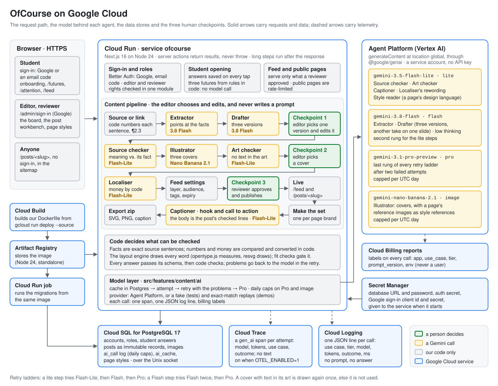

# OfCourse

OfCourse helps international students decide where and what to study abroad, starting with Australia. A student answers a few taps about her situation and sees three possible futures side by side, built around cost, staying and career, with nothing ranked or recommended. Around that sits a content engine: an editor turns a source (pasted text or a link) into a feed post for students, Gemini does the work only a model can do, code checks every fact and number against the source, and a reviewer approves the post before anyone sees it. It is our entry to the AI Builder Cup under "Media, Content & Digital Experiences".

**Who it is for**

- **Students** from countries such as Nepal, India and Thailand, choosing a course and a route abroad. They sign in on `/` and use the opening, the futures and the feed.
- **Editors and reviewers** on the marketing team. They sign in with Google on `/admin/sign-in`, make posts and publish them.
- **Anyone** who finds a post on Instagram or Google. Each live post has a public page at `/posts/<slug>`.



## Contents

- [Architecture](#architecture)
- [The agents](#the-agents)
- [How a person approves every post](#how-a-person-approves-every-post)
- [What code decides](#what-code-decides)
- [Live results](#live-results)
- [The student side](#the-student-side)
- [How it scales](#how-it-scales)
- [Run it locally](#run-it-locally)
- [Deploy](#deploy)
- [Tests](#tests)
- [Decision register](#decision-register)
- [How it was built](#how-it-was-built)
- [Third-party code](#third-party-code)
- [Licence](#licence)

## Architecture

One Next.js 16 app runs as one Cloud Run service. The browser talks to it over HTTPS. Server code reads and writes Cloud SQL, and the model layer (`src/features/content/ai/`) is the only app code that calls Gemini. Slow steps, such as the source check, run after the response is sent (Next's `after()`), with a lock row per post and step in Postgres so a second click cannot start the same step twice.

### Google Cloud services

| Service | What it does here |
| --- | --- |
| **Cloud Run** | Runs the app (service `ofcourse`, Node 24, standalone Next build). Also runs the database migrations as a Cloud Run job from the same image. |
| **Cloud SQL for PostgreSQL 17** | Every record: accounts and roles, student answers, posts as immutable records, images (`content_asset`), the model call log (`ai_call`, which the daily caps count) and the answer cache (`ai_cache`). The app connects over the Unix socket Cloud Run mounts. |
| **Secret Manager** | The database URL and password, the auth secret and the Google sign-in client, passed to the service as environment variables when it starts. Nothing secret is built into the image. |
| **Agent Platform (Vertex AI)** | Gemini, through `@google/genai` with `vertexai: true`, at location `global`; the project is configuration (`GOOGLE_CLOUD_PROJECT`). Authentication is Application Default Credentials: the service account on Cloud Run, `gcloud` on a laptop. No API key. Models below. |
| **Cloud Trace** | With `OTEL_ENABLED=1`, each Gemini attempt is an OpenTelemetry span named `gen_ai <use case>`, with the GenAI attributes (`gen_ai.request.model`, input and output tokens) and ours (`ofcourse.use_case`, `ofcourse.tier`, `ofcourse.prompt_version`, `ofcourse.cached`, `ofcourse.outcome`). No prompt, answer, source text or user id goes on a span. Tracing is off by default and in tests. |
| **Cloud Logging** | One JSON line per finished Gemini call (`event: "ai_call"`: use case, tier, model, prompt version, cached, outcome, attempt, milliseconds, token counts), which Cloud Logging parses from stdout. |
| **Cloud Billing** | Every Gemini request carries labels (`app`, `use_case`, `tier`, `prompt_version`, `env`), so spend splits by use case in billing reports. Never a user id. |
| **Cloud Build** | Builds our `Dockerfile` when we deploy with `gcloud run deploy --source .`. |
| **Artifact Registry** | Stores the built image that Cloud Run and the migrations job run. |

### Models

Model ids are configuration (`GEMINI_*_MODEL`); these are the ones we run (ADR-115). Tiers are in `src/features/content/ai/config.ts`, and each prompt's tier is in `src/features/content/ai/prompts.ts`.

| Tier | Model | Used for |
| --- | --- | --- |
| `lite` | `gemini-3.5-flash-lite` | The source check, the art check, caption hooks, market rewording, a page's design language |
| `flash` | `gemini-3.8-flash`, low thinking | Extraction, the three draft versions, another take on one slide; the second rung for lite steps |
| `pro` | `gemini-3.1-pro-preview` | The last rung of every retry ladder; capped per UTC day |
| `image` | `gemini-nano-banana-2.1` | Cover art, with a page's reference images sent as style references; capped per UTC day |

Every JSON call goes through the same ladder (`src/features/content/ai/client.ts`): the cache, then the first model, then a retry that sends back the list of problems with the last answer, then Pro. A lite step climbs lite → flash → pro; a Flash step tries Flash twice, then Pro. Pro and image calls reserve a slot under a daily cap before they are made (`AI_DAILY_CAP_PRO`, `AI_DAILY_CAP_IMAGE`; a missing cap reads as 0, which refuses the call). A failed step keeps the work made before it and offers "Try again" for that step only.

## The agents

Each agent is one job with its own versioned prompt (in `prompts.ts`; the cover prompt is built by code in `art.ts`), and code checks every answer before it is used. They are steps in a pipeline our code runs, not autonomous agents: none calls another or chooses its own tools.

| Agent | What it does | Model | What code checks |
| --- | --- | --- | --- |
| **Extractor** | Picks the source sentences that state facts, by their number (`¶2.3`), plus up to three key ideas | 3.8 Flash | Code numbers the sentences and copies each chosen one word for word, so a fact is always exact source text. A title that claims something no paragraph says is listed as "Headline claim not in the article" and cannot be used on a slide. |
| **Drafter** | Writes three versions of the post for the chosen template, each from a different angle; "Another take" redrafts one slide | 3.8 Flash | Every slot filled in the template's order, within its limits; each factual slot cites facts that exist and uses only their numbers; no banned phrases; the picture description has no digits, quotation marks or brand names. |
| **Source checker** | Says whether a slide sentence means the same as the fact it is bound to | 3.5 Flash-Lite | A sentence found word for word in the source needs no call. A number the source does not have is "not found", whatever the model says. The model's "supported" counts only when the paragraph it cites holds the sentence's numbers. A flagged sentence shows the source sentence it should match. |
| **Illustrator** | Draws three cover options in the page's design language | Nano Banana 2.1 | Code builds the prompt (the editor never writes one); a cover idea with a digit, a quotation mark or a brand name is refused before any call. Every word on a slide is drawn by code, never by the image model. |
| **Art checker** | Looks at each new cover for any text, letter, number, logo or watermark | 3.5 Flash-Lite | A cover with text in it is never offered: one more is drawn, and if that also has text, the cover has no art. Art the check could not read is treated as not clean. |
| **Localiser** | Makes a market version (Nepal, India, Thailand) | Code; rewording on 3.5 Flash-Lite | Code converts every money figure at the rate file's dated mock rate and prints the rate under it. The optional rewording may not add or change a number. |
| **Captioner** | Writes the opening hook and the call to action of an Instagram caption | 3.5 Flash-Lite | Code puts the post's own checked lines between them and the hashtags from its tags; the model's part may carry no number and stays within the word budget. |
| **Style reader** | Describes a page's design language (art style, copy style, closest template) from one or two reference images | 3.5 Flash-Lite | Lengths; no digits, quotation marks or brand names in the art style; the template id must exist. Colours and fonts stay in the brand file. The editor edits and saves the result. |

The student futures use no model: they are rules in code over a mock catalogue (`src/features/engine/`).

## How a person approves every post

The editor never writes a prompt (ADR-129). "Make post" runs extraction, the three versions and the text checks, then stops where a person has to choose:

1. **Pick a version and edit it.** The editor picks one of the three versions, edits text on the slide preview (the fit checks update while typing, and a changed factual sentence is source-checked when the editor leaves the slot), and can ask for another take on one slide. Every saved version is kept and can be restored.
2. **Pick a cover.** "Make covers" draws three options under the settled text; the editor picks one or asks for another set.
3. **Review and publish.** The editor sets the feed settings and sends the post to review. A sentence the source check did not find blocks sending until it is removed or marked as editorial opinion. A reviewer sees the slides, facts, source-check results and settings, and either approves and publishes or sends it back with a reason. An editor without the reviewer right cannot approve; a post approved by its own maker is labelled "self-reviewed". What the reviewer approved is pinned by id, and that is exactly what the feed and the public page show.

After a post is live, "Make the set" makes an Instagram version for each page brand and a quote card, each with its caption, exported as a zip of SVGs, PNGs and `caption.txt`. Nothing is posted to any platform by the app.

## What code decides

ADR-112: code decides whatever can be checked; the model proposes.

- **Facts are exact source sentences.** The model points at sentence numbers; code copies the text.
- **Numbers and money are code.** Code reads numbers, percentages and currency amounts, rules a sentence unsupported when it carries a figure its source lacks, and converts currencies from a dated rate file. A bare `$` is never converted, because it is ambiguous.
- **Code draws every word.** The layout engine (`src/features/content/layout/`) measures text with opentype.js against the brand's font files and draws slides as SVG, rasterised by resvg with those same fonts only. Fit checks (slot lengths, overflow, glyphs the font lacks, contrast, smallest text at phone width) gate every render.
- **Schemas, then checks.** Each answer is parsed against a simple model-facing schema, then checked by code; the problems go back to the model in the retry. Pasted sources are sent as data with a rule that they are never instructions.
- **Daily caps** on Pro and image calls, counted in the database.
- **A fake provider and exact-match replays.** With `AI_PROVIDER=fake`, a deterministic provider answers from the request's data and never spends; the end-to-end tests run on it, and the unit tests swap it in for the real client. A demo source pasted exactly as recorded can be answered from a recording, checked again like a live answer; any changed word means a live call.

## Live results

Run on the `applyims` Google Cloud project, 9 to 11 October 2026:

- **Accuracy eval** (`bun run ai:eval`, `src/features/content/ai/evals/g2-claims.ts`): 30 claims over 5 small sources, 10 of them planted (a changed number, a changed unit, a generalisation, a claim only in the title). With the source check on Flash-Lite: **10 of 10 planted errors caught, 0 false alarms** (the pass bar is 10 of 10 with at most 2).
- **Smoke run** (`bun run ai:smoke`), one live call per use case: each answered in 1 to 15 seconds (the source check on Flash-Lite 1.1 s, the three-version draft 14.8 s).

## The student side

The student slice (product truth in [PRODUCT.md](PRODUCT.md), intent in [docs/student-opening-three-futures/intent.md](docs/student-opening-three-futures/intent.md)):

- **Sign-in** on `/` with Google (a six-digit email code is built too, off on the page until an email provider is configured); one account per address, whichever way she signs in. Staff sign in separately on `/admin/sign-in`, Google only.
- **The opening** (`/onboarding/...`): a welcome, an optional comic-character question, then one question per screen about her facts (where she is now, budget, who pays, dates, qualification, English), what she would study and where and how she would live, then what she wants after graduating. Each step says why it asks, and "Not sure" is always allowed: it stores a default marked as assumed. Every tap is saved, so she can continue on another device, and `/onboarding` resumes where she left off.
- **Three futures** (`/futures`): one route built around cost, one around staying, one around career, side by side, with what each gives and costs her. The chips under each future show the answers it rests on; changing one redraws all three. Figures come from a mock Australia catalogue and say so.
- **Her attention** (`/attention`): ten coins to spend across her life values, or to put off.
- **The feed** (`/feed`): every live post, with chips for destination, home country, theme and age band, and a search box. Each post page lists related posts from shared sources and tags, computed in code.

## How it scales

The course finder lets a student describe what she enjoys in her own words and finds courses by meaning.

- **Rules decide, the model explains, and code checks the model.**
  - Rules in code decide which courses she can take (the levels her qualification opens, her destination, her budget), each course's visa and PR lines, and every figure.
  - The model turns her words into a vector and writes a short "why" for each of the top three courses.
  - Code checks every "why": it must quote the course description word for word, add no figure and rank nothing. A "why" that fails is replaced by a template.
- **One meaning query and one keyword query, in the Postgres the app already uses** (pgvector on Cloud SQL).
  - The meaning query finds the nearest courses by cosine distance.
  - The keyword query, Postgres full-text search on the same words, runs beside it for comparison.
  - Below a thousand rows an exact scan is fast enough. Beyond that, an index on the same column takes over, and no new service is needed.
- **A production catalogue loads through a sync job.** `bun run finder:seed`, run as a Cloud Run job, upserts the catalogue and removes the courses it dropped. It re-embeds only the courses whose name or description changed, or that another model embedded.
- **The catalogue is generated sample data**, because the business's own catalogue is not public. `scripts/finder-build.ts` generated the 479 courses from the brief in `src/features/finder/data/GENERATE.md`, and every card says "sample data".
- **Measured on queries the catalogue never saw.** An agent that read only the list of fields wrote 20 queries.
  - **19 of 20** put an expected course in the top three, against a bar of 16. The eval gives each search the same 2 seconds and one 5-second retry that a student gets.
  - Text with fewer than three content words is "nothing close", with no search. Longer text needs a similarity of at least 0.5, a round floor that was not fitted on these 20 queries.
  - The run is in [docs/course-finder/eval.md](docs/course-finder/eval.md) (`bun run finder:eval`).

## Run it locally

Prerequisites: [Bun](https://bun.sh) 1.3 or later (the only package manager the repo accepts), Node 22 or later, and Docker for Postgres.

```bash
bun install
cp .env.example .env    # then fill in the keys below
bun run dev             # checks port 3000, starts Postgres 17 in Docker on 127.0.0.1:5433, migrates, runs Next on 3000
```

`bun run dev` leaves Postgres running when Next stops; `docker compose stop` stops it.

### Environment keys

| Key | What it is for |
| --- | --- |
| `DATABASE_URL` | The Postgres connection (the Docker database locally) |
| `BETTER_AUTH_SECRET`, `BETTER_AUTH_URL` | The auth secret and the app's public origin |
| `GOOGLE_CLIENT_ID`, `GOOGLE_CLIENT_SECRET` | Google sign-in |
| `DEV_LOGIN_SECRET` | Development only: lets `POST /api/dev-login` sign in as any email, for tests and the browser console. Answers 404 in production. Never set it on a server strangers can reach. |
| `AI_PROVIDER` | `fake` for the deterministic fake provider (no Google Cloud needed, nothing spent); anything else calls Agent Platform |
| `GOOGLE_CLOUD_PROJECT`, `GOOGLE_CLOUD_LOCATION` | The Agent Platform project, and its location (default `global`) |
| `GEMINI_LITE_MODEL`, `GEMINI_FLASH_MODEL`, `GEMINI_PRO_MODEL`, `GEMINI_IMAGE_MODEL` | The model per tier (the lite tier falls back to the Flash model when unset) |
| `AI_DAILY_CAP_PRO`, `AI_DAILY_CAP_IMAGE` | Calls allowed per UTC day; missing means 0 |
| `OTEL_ENABLED` | `1` sends traces to Cloud Trace; off when unset |
| `TRUSTED_PROXY_HOPS` | Which forwarded address the public pages' rate limit trusts, counted from the right (default 1) |
| `RESEND_API_KEY`, `EMAIL_FROM` | Optional: send email sign-in codes through Resend. Without them, outside production, the code is printed to the server console. |
| `NEXT_PUBLIC_SITE_URL` | Optional: the public origin for absolute links (falls back to `BETTER_AUTH_URL`) |

To run with no Google Cloud account, set `AI_PROVIDER` to `fake`. To run the real models, sign in with `gcloud auth application-default login`, set the project and the model keys, and give the two caps a value.

Without Google sign-in keys, sign in from the browser console on `http://localhost:3000` (with `DEV_LOGIN_SECRET` set):

```js
await fetch('/api/dev-login', { method: 'POST', headers: { 'content-type': 'application/json', 'x-dev-login-secret': '<DEV_LOGIN_SECRET>' }, body: JSON.stringify({ email: 'you@example.com', name: 'You' }) }); location.href = '/start'
```

The first account to sign in on the admin page of an empty database becomes superadmin; a superadmin gives the editor and reviewer rights in the users admin at `/admin/users`.

## Deploy

The runbook is [docs/hackathon/deploy.md](docs/hackathon/deploy.md): enabling the APIs, the Cloud SQL instance, the runtime service account and its roles, the secrets, `gcloud run deploy --source .`, the migrations job, Google sign-in redirect URIs, the spend cap and a smoke check, and the tear-down. The image is built from the repo's `Dockerfile` (Node 24, Bun to install and to run the migrations, the standalone Next server on port 8080).

## Tests

| Command | What it runs |
| --- | --- |
| `bun run test:run` | Unit and component tests (`bun test` with happy-dom). They swap in the fake provider and never call a model. |
| `bun run test:db` | **Wipes the development database**, then runs the database-backed suites |
| `bun run test:e2e` | Playwright against a dev server it starts with `AI_PROVIDER=fake` and the dev login |
| `bun run ai:smoke` | One live call per use case on Agent Platform (spends real calls) |
| `bun run ai:eval` | The accuracy eval above, live (spends real calls) |
| `bun run ai:replays` | Records the demo replays from live calls |
| `bun run lint`, `bun run type-check` | Biome and TypeScript |

Database tests can also run by path: `DB_TESTS=1 DATABASE_URL=… bun test <file>`.

## Decision register

Every product and technical decision is recorded in [docs/decisions/](docs/decisions/README.md), ADR-001 to ADR-132, one file per decision, superseded and never deleted. Some ADRs describe work that has not been built yet; the code is the record of what has. The ones behind this README: ADR-112 (code decides what can be checked), ADR-115 (the models on `global`), ADR-119 (third-party code), ADR-120 (hosting), ADR-129 (no prompts for the editor), ADR-130 (a design language per page) and ADR-131 (a public page per post).

## How it was built

OfCourse was started on 5 Oct 2026 from Heubert's Next.js starter: Google sign-in, roles, a users admin and the Drizzle setup are that scaffolding; everything else was built for the AI Builder Cup. The history shows each step from that first commit.

## Third-party code

Outside code enters as a dependency or as an idea written in our own code, never as a copied application (ADR-119).

### Runtime dependencies

Every entry in `dependencies` in `package.json`, with the version installed and the licence read from its own `package.json` in `node_modules`.

| Package | Version | Licence |
| --- | --- | --- |
| `@google-cloud/opentelemetry-cloud-trace-exporter` | 3.1.0 | Apache-2.0 |
| `@google/genai` | 2.27.0 | Apache-2.0 |
| `@opentelemetry/api` | 1.9.1 | Apache-2.0 |
| `@opentelemetry/core` | 2.12.0 | Apache-2.0 |
| `@opentelemetry/resources` | 2.12.0 | Apache-2.0 |
| `@opentelemetry/sdk-trace-base` | 2.12.0 | Apache-2.0 |
| `@opentelemetry/sdk-trace-node` | 2.12.0 | Apache-2.0 |
| `@radix-ui/react-avatar` | 1.2.6 | MIT |
| `@radix-ui/react-checkbox` | 1.3.11 | MIT |
| `@radix-ui/react-dialog` | 1.1.23 | MIT |
| `@radix-ui/react-label` | 2.1.15 | MIT |
| `@radix-ui/react-popover` | 1.1.23 | MIT |
| `@radix-ui/react-progress` | 1.1.16 | MIT |
| `@radix-ui/react-scroll-area` | 1.2.18 | MIT |
| `@radix-ui/react-select` | 2.3.7 | MIT |
| `@radix-ui/react-separator` | 1.1.15 | MIT |
| `@radix-ui/react-slot` | 1.3.3 | MIT |
| `@radix-ui/react-switch` | 1.3.7 | MIT |
| `@radix-ui/react-tabs` | 1.1.21 | MIT |
| `@radix-ui/react-tooltip` | 1.2.16 | MIT |
| `@resvg/resvg-js` | 2.6.2 | MPL-2.0 |
| `better-auth` | 1.7.7 | MIT |
| `class-variance-authority` | 0.7.1 | Apache-2.0 |
| `cmdk` | 1.1.1 | MIT |
| `cn` | 0.4.0 | MIT |
| `drizzle-orm` | 0.45.3 | Apache-2.0 |
| `fflate` | 0.8.3 | MIT |
| `lucide-react` | 1.52.0 | ISC |
| `next` | 16.3.8 | MIT |
| `opentype.js` | 2.0.0 | MIT |
| `postgres` | 3.4.9 | Unlicense |
| `react` | 19.3.0 | MIT |
| `react-dom` | 19.3.0 | MIT |
| `server-only` | 0.0.1 | MIT |
| `shadcn` | 4.21.1 | MIT |
| `sonner` | 2.0.8 | MIT |
| `tw-animate-css` | 1.4.0 | MIT |
| `vaul` | 1.1.2 | MIT |
| `zod` | 4.6.5 | MIT |

`@resvg/resvg-js` is MPL-2.0, a file-level copyleft licence: we use it unmodified as a library and ship none of its source files changed. `postgres` is released under the Unlicense (public domain). The seven OpenTelemetry and Cloud Trace packages are the tracing added for Cloud Trace.

### Development tools

Not part of the running app: `@biomejs/biome` (MIT OR Apache-2.0), `@happy-dom/global-registrator` (MIT), `@playwright/test` (Apache-2.0), `@tailwindcss/postcss` (MIT), `@testing-library/jest-dom` (MIT), `@testing-library/react` (MIT), `@types/node`, `@types/react`, `@types/react-dom` (MIT), `bun-types` (MIT), `cross-env` (MIT), `drizzle-kit` (MIT), `husky` (MIT), `lint-staged` (MIT), `tailwindcss` (MIT; its generated CSS is in the app), `typescript` (Apache-2.0).

### Code taken into the repo, and ideas ported

- **shadcn/ui components** (MIT): the files in `src/shared/components/ui` were generated by the shadcn CLI from shadcn/ui.
- **Cloud Run Dockerfile**: follows the pattern of vercel/next.js `examples/with-docker` (MIT): a build stage, then a runtime stage that copies `.next/standalone`, `.next/static` and `public` and runs `node server.js`. Ours adds Bun's binary to install from the lockfile and the files the migrations job needs.
- **The sentence merge rule** (`src/features/content/text/sentences.ts`): our own code. It splits with the built-in `Intl.Segmenter` and merges fragments it broke at abbreviations, initials and quoted speech. We tested `sentence-splitter` and Wikimedia's `sentencex` (both MIT) as replacements on our fixtures; both failed one of them, so neither is used and no code from either is included.

### Fonts and images

- **Barlow and Barlow Condensed** (SIL Open Font License 1.1, copyright 2017 The Barlow Project Authors): the slide fonts in `src/features/content/assets/fonts/` with the licence beside them in [`OFL.txt`](src/features/content/assets/fonts/OFL.txt), and the web fonts of the Industry design system, self-hosted through `next/font/google`.
- **Noto Sans Devanagari and Noto Sans Thai**, Regular and Bold (SIL Open Font License 1.1, copyright 2022 The Noto Project Authors): the slide fonts for Nepali, Hindi and Thai text, in `src/features/content/assets/fonts/`, unmodified from the official release builds (notofonts/devanagari `NotoSansDevanagari-v2.007`, notofonts/thai `NotoSansThai-v2.002`, the `full/ttf` files), with their licences beside them in [`OFL-NotoSansDevanagari.txt`](src/features/content/assets/fonts/OFL-NotoSansDevanagari.txt) and [`OFL-NotoSansThai.txt`](src/features/content/assets/fonts/OFL-NotoSansThai.txt).
- **Art library images** (`src/features/content/assets/library/open-book.png`, `new-head.png`): the team's own work, from its admin design files, under this repository's licence.
- **The duck** (`public/brand/duck.png`) and **the splash video** (`public/brand/quack.mp4`): the team's own work, from its student design assets, under this repository's licence.

## Licence

Copyright 2026 Heubert. All rights reserved: see [LICENSE](LICENSE). The third-party code, fonts and assets listed above stay under their own licences.
